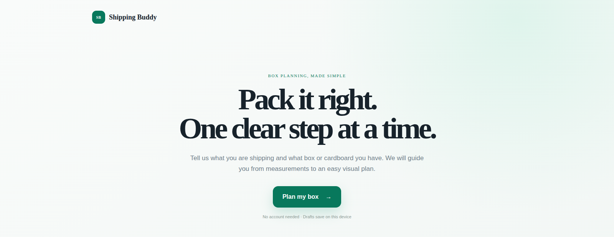
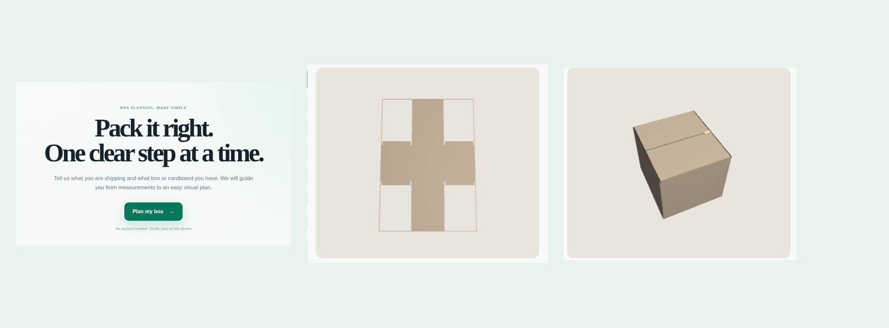

# Shipping Buddy

**Pack it right. One clear step at a time.**

Shipping Buddy is a local-first box-planning tool for people who ship things and are tired of guessing which box to use. Tell it what you are shipping and what cardboard you already have, and it works out the rest: a calculated fold layout, an interactive 3D walkthrough of every cut and fold, and numbered build steps you can follow at the packing table.

No account. No server. Your measurements never leave the device.



## What it does

- **Guided planner, one question at a time.** Item, protection, box source, fit, build. Five short steps instead of one giant form.
- **Real geometry, not vibes.** Enter a measured item envelope, pick a parametric shape (rectangular, cylinder/tube, rounded/ellipsoid, or a measured L/U profile) and a construction profile, and Shipping Buddy calculates the exact net your cardboard needs.
- **Build from what you have.** Start from a flat sheet of cardboard, a common stock box, or a box already on your shelf. Existing boxes get their own assembly workflows, including height cut-downs, horizontal shrinks, flatten and re-score, corner reforms, telescope builds, and splice prototypes.
- **Watch it fold before you cut.** A responsive Three.js preview animates the whole build, flat net to finished box, with a slider to scrub to any point and per-step checkpoints.
- **A plan you can print.** SVG dieline, generated face/score/cut counts, and numbered steps with tools, safety checks, and expected measurements at every stage.
- **Honest fit checks.** If your sheet is too small, it says so, by how much, and what size would work. It never silently resizes your material.
- **Local-first.** Drafts autosave on the device, with JSON export/import for backup. Inches in the UI (quarter-inch checkpoints), millimetres under the hood.




## Want to test this? Do this

You need Node.js 22+ and pnpm.

```bash
git clone https://github.com/AshbyCollado/shippingbuddy.git
cd shippingbuddy
pnpm install
pnpm dev
```

Open `http://localhost:3000`, hit **Plan my box**, and follow the five steps. To see the full build walkthrough fast, measure any item you have nearby and choose **Flattened cardboard** as the starting material.

Production build:

```bash
pnpm build
pnpm start
```

## Testing

Verified against the current codebase:

```bash
pnpm lint       # ESLint, clean
pnpm typecheck  # tsc --noEmit, clean
pnpm test       # Vitest: 156 tests across 25 files, all passing
pnpm test:e2e   # Playwright end-to-end suite (planner flow, cut-and-fold build, accessibility, release flow)
pnpm build      # Next.js production build, all routes static
```

The E2E suite drives the real app in a real browser, including axe accessibility checks on every planner route and deterministic fold-checkpoint assertions on the 3D build.

Current E2E status (Nov 2026, low-power VM with software-rendered WebGL): 18 of 33 passing. The known failures are tracked honestly rather than hidden: axe reports color-contrast violations on the fitting Build routes, and several camera/telemetry tests time out under SwiftShader on shared CPU. The planner flow, release flow, and instruction-rail tests pass.

## Tech stack

- **Next.js 16 / React 19 / TypeScript** (App Router, static routes)
- **Three.js + React Three Fiber + drei** for the corrugated-cardboard 3D preview
- **Zustand** for planner state, **Zod** for schema validation, **GSAP** for animation
- **Vitest + fast-check** for unit and property tests, **Playwright + axe** for E2E and accessibility

## Scope and honesty

Shipping Buddy is geometry-driven. It does not claim carrier compliance, structural safety ratings, or physical load validation. Measure your item, follow the plan, and remeasure the finished inside, the walkthrough's last step exists for a reason.

## Rendering references

The corrugated face geometry and hinge hierarchy are a modern Three.js/R3F adaptation of the MIT-licensed [Threejs-folding-cardboard-box-tutorial](https://github.com/uuuulala/Threejs-folding-cardboard-box-tutorial) pinned at commit [`ba9e8b6b73044d48e4c362ecfbe1a3ffe504adf8`](https://github.com/uuuulala/Threejs-folding-cardboard-box-tutorial/commit/ba9e8b6b73044d48e4c362ecfbe1a3ffe504adf8). The immutable FoldNet/playbook ideas are an independent modern implementation guided by the MIT-licensed [georgiee/origami](https://github.com/georgiee/origami) project; its legacy Three r86 runtime is not installed.

The copied/adapted renderer notice is preserved in [THIRD_PARTY_NOTICES.md](./THIRD_PARTY_NOTICES.md).

## License

MIT. See [LICENSE](./LICENSE).
