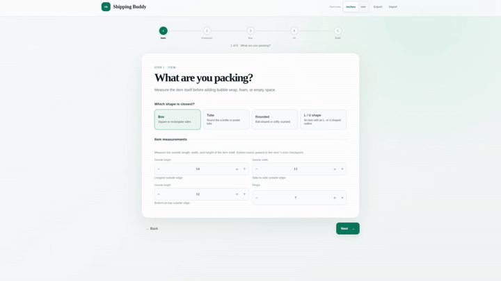
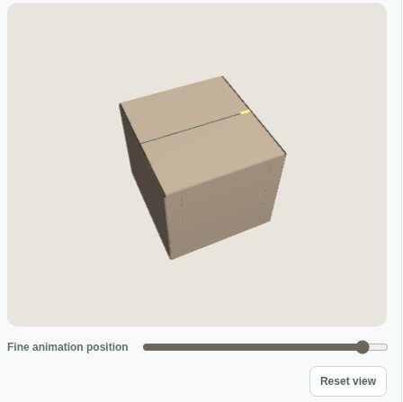

# Shipping Buddy



Shipping Buddy is a parametric box-planning system that runs entirely in the browser. Given a measured item envelope and a starting material (a flat cardboard sheet, a stock box, or a box already on hand), it computes the construction: the fold net, the cut and score layout, and a step-by-step build sequence, then renders the whole build as an interactive 3D animation before any cardboard is cut.

There is no backend. All geometry, state, and drafts live on the device.

## How it works

- **Parametric item model.** The item is described as a measured envelope with a shape class (rectangular, cylinder/tube, rounded/ellipsoid, or a measured L/U profile), plus cushioning and tolerance per axis. Internally everything is millimetres; the UI works in inches with quarter-inch checkpoints.
- **Construction profiles.** A profile turns the envelope into a buildable plan: generated faces, scores, and cuts for flat-sheet construction, or an assembly transformation for an existing box (height cut-down, horizontal shrink, flatten/re-score/rejoin, corner reform, telescope, splice prototype).
- **FoldNet.** Flat-sheet plans produce an immutable fold net: faces, hinges, and adjacency as data. One authoritative playbook derives everything downstream from that data, the SVG dieline, the numbered steps, and the 3D animation, so the three can never disagree.
- **3D preview.** The net is rendered as corrugated cardboard in Three.js (React Three Fiber), with deterministic fold checkpoints: scrubbing the animation to a percentage always lands on the same pose, which is what the end-to-end tests assert against.
- **Fit as a hard check.** If the material cannot contain the generated net, the planner says so with the exact shortfall. It never silently rescales material or geometry.
- **Local-first state.** Planner state is a versioned, Zod-validated draft in localStorage with JSON export/import. No account, no network calls.



## Run it

```bash
git clone https://github.com/AshbyCollado/shippingbuddy.git
cd shippingbuddy
pnpm install
pnpm dev
```

Open `http://localhost:3000`. Production build:

```bash
pnpm build
pnpm start
```

## Testing

```bash
pnpm lint       # ESLint, clean
pnpm typecheck  # tsc --noEmit, clean
pnpm test       # Vitest: 156 tests across 25 files, all passing
pnpm test:e2e   # Playwright: planner flow, cut-and-fold build, accessibility, release flow
pnpm build      # Next.js production build, all routes static
```

Unit and property tests (Vitest + fast-check) cover the geometry and playbook layers. The Playwright suite drives the real application, including axe accessibility checks on the planner routes and screenshot/checkpoint assertions on the 3D build.

Current E2E status (Nov 2026, low-power VM with software-rendered WebGL): 18 of 33 passing. Known failures, stated plainly: axe reports color-contrast violations on the fitting Build routes, and several camera/telemetry tests time out under SwiftShader on shared CPU. The planner flow, release flow, and instruction-rail tests pass.

## Stack

- **Next.js 16 / React 19 / TypeScript** (App Router, fully static routes)
- **Three.js + React Three Fiber + drei** for the cardboard renderer
- **Zustand** state, **Zod** schemas, **GSAP** animation
- **Vitest + fast-check**, **Playwright + axe** for verification

## Scope

Shipping Buddy is a geometry system. It does not claim carrier compliance, structural safety ratings, or physical load validation. The final step of every build plan is remeasuring the finished inside, because the plan is only as good as the measurements it started from.

## Rendering references

The corrugated face geometry and hinge hierarchy are a modern Three.js/R3F adaptation of the MIT-licensed [Threejs-folding-cardboard-box-tutorial](https://github.com/uuuulala/Threejs-folding-cardboard-box-tutorial) pinned at commit [`ba9e8b6b73044d48e4c362ecfbe1a3ffe504adf8`](https://github.com/uuuulala/Threejs-folding-cardboard-box-tutorial/commit/ba9e8b6b73044d48e4c362ecfbe1a3ffe504adf8). The immutable FoldNet/playbook ideas are an independent modern implementation guided by the MIT-licensed [georgiee/origami](https://github.com/georgiee/origami) project; its legacy Three r86 runtime is not installed.

The copied/adapted renderer notice is preserved in [THIRD_PARTY_NOTICES.md](./THIRD_PARTY_NOTICES.md).

## License

MIT. See [LICENSE](./LICENSE).
